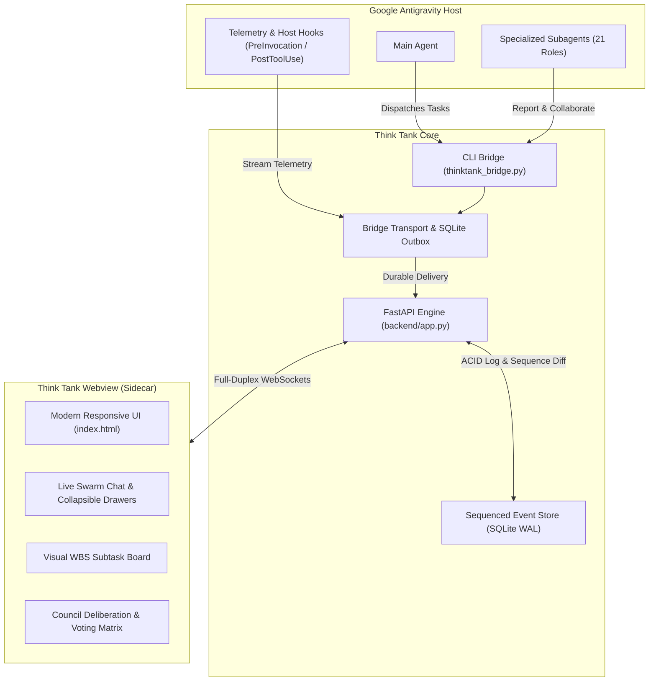

# 🏛️ Antigravity Think Tank

[](LICENSE)
[](package.json)
[](plugin.json)
[](#architecture-overview)

> **Autonomous Multi-Agent Command Room & Real-Time Swarm Orchestrator for Google Antigravity.**

Think Tank is an open-source command room, interactive sidecar Webview, and multi-agent coordination engine built specifically for **Google Antigravity**.

Instead of firing off loose prompts to isolated subagents and crossing your fingers, Think Tank turns your agent swarm into a structured, self-governing council. It provides real-time WebSocket state streaming, live inter-agent chat feeds, collapsible accordion drawers for internal agent thoughts and deep reports, a visual Work Breakdown Structure (WBS) board, and a battle-tested 7-round Council Consensus & Critique Matrix.

---

## ⚡ What Makes Think Tank Different?

* **Live Swarm Feed & Inter-Agent Chat**: Watch subagents talk to each other in real time like an active Slack or Discord channel. No mystery handoffs or invisible handwaves—you see who delegated what, what tools were called, and the exact response.
* **Collapsible Thought & Report Drawers (`<details class="tt-drawer">`)**: Long walls of chain-of-thought and detailed benchmark reports are automatically tucked into clean, interactive accordion drawers. Read high-level summaries at a glance, or expand to inspect raw findings without cluttering the chat.
* **Live Thinking & Working Status Strip**: A dedicated real-time telemetry strip displays active working indicators, current tool invocations, and lifecycle states so you always know what each subagent is chewing on.
* **Council Consensus & Deliberation Matrix**: Built-in 7-round debate ceiling with structured critique rounds, trade-off weighing, and automated consensus tracking. When the council agrees, the decision card cleanly transitions to a final summary.
* **Visual WBS Subtask Board**: Break complex projects into structured tasks with assigned agent roles, dependencies, lifecycle badges (`TODO`, `IN_PROGRESS`, `BLOCKED`, `DONE`), and verified evidence attachments.
* **Offline-Resilient Event Store & SQLite Outbox**: Backed by an append-only sequenced event log and a persistent SQLite outbox with automatic replay, ensuring zero dropped messages even across network blips or daemon restarts.
* **Bilingual UI (English & Persian)**: Native right-to-left (RTL) and left-to-right (LTR) support with custom bundled typography (**Outfit** & **Vazirmatn**), selectable with a single toggle.

---

## 🏗️ Architecture Overview



---

## 👥 Subagents Roster (21 Specialized Roles)

Think Tank ships with a comprehensive roster of 21 ready-to-run subagent definitions in the `agents/` directory:

| Role | Filename | Description & Core Focus |
| :--- | :--- | :--- |
| **Team Manager** | `team-manager.md` | Autonomous project supervisor. Decomposes goals into WBS tasks, assigns agent ownership, monitors blockers, and enforces delivery gates. |
| **Council Architect** | `council-architect.md` | System design specialist. Evaluates technical trade-offs, drafts architecture RFCs, and builds consensus during council debates. |
| **Council Critic** | `council-critic.md` | Red-team devil's advocate. Identifies hidden assumptions, security risks, regression traps, and flawed coordination before execution. |
| **Integration Reviewer** | `integration-reviewer.md` | Verifies worker outputs against API contracts, UI schemas, and backend invariants before approving merge gates. |
| **Data Intelligence Curator** | `data-intelligence-curator.md` | Discovers, normalizes, and classifies data records with explicit confidence, sensitivity, and provenance tracking. |
| **Evidence Critical Reviewer** | `evidence-critical-reviewer.md` | Independently tests factual assertions, detects contradictions, and traces source provenance. |
| **Requirements Auditor** | `requirements-auditor.md` | Maps user requirements and acceptance criteria directly to code, tests, and execution evidence. |
| **Context Memory Curator** | `context-memory-curator.md` | Manages lean context handoffs between subagents, preventing token bloat and hallucination drift. |
| **Performance & Cost Analyst** | `performance-cost-analyst.md` | Audits agent actions for redundant delegations, duplicate scans, token waste, and latency bottlenecks. |
| **UI / Frontend Designer** | `ui-frontend-designer.md` | Modern frontend architect. Crafts tactile microinteractions, semantic design tokens, responsive layouts, and WCAG 2.2 accessibility. |
| **Code Reviewer** | `code-reviewer.md` | Read-only scoped diff reviewer. Flags defects with exact path, line numbers, severity, and test recommendations. |
| **QA Reviewer** | `qa-reviewer.md` | Risk-based acceptance testing specialist. Formulates and executes targeted verification checklists. |
| **Research Scout** | `research-scout.md` | Fast, scoped codebase explorer and documentation retriever. Cites exact lines and surfaces technical unknowns. |
| **Backend Auditor** | `backend-auditor.md` | Audits APIs, database transactions, authz policies, and secret handling for security and reliability regressions. |
| **Visual QA** | `visual-qa.md` | Audits rendered UI against acceptance criteria across mobile, tablet, and desktop breakpoints. |
| **Agent Evaluator** | `agent-evaluator.md` | Benchmarks custom subagents and skill instructions against objective rubrics and evidence fixtures. |
| **Skill Coach** | `skill-coach.md` | Optimizes custom agent instructions using structured decision frameworks (JEV & SUBQ). |
| **Firestore Rules Author** | `firestore-rules-author.md` | Dedicated specialist for authoring and verifying Cloud Firestore security rules. |
| **Flutter A11y Specialist** | `flutter-a11y-agent.md` | Audits Flutter mobile apps and widgets for accessibility semantics and WCAG conformance. |
| **WordPress / WooCommerce SRE** | `wp-technical-operator.md` | DevOps mechanic for e-commerce stores. Diagnoses database health, payment gateways, and automated repairs. |
| **E-Commerce SEO Specialist** | `ecommerce-seo-operator.md` | High-CTR metadata strategist and catalog copywriter. Optimizes titles, descriptions, and conversion hooks. |

---

## 🧰 Integrated Skills Directory (19 Core Skills)

Every subagent is backed by specialized execution skills in the `skills/` directory:

| Skill | Path | Purpose |
| :--- | :--- | :--- |
| `task-orchestration` | `skills/task-orchestration/` | WBS decomposition, subtask lifecycle management, and live board synchronization. |
| `think-room` | `skills/think-room/` | 7-round debate coordination, council voting protocols, and consensus tracking. |
| `quality-gate` | `skills/quality-gate/` | Pre-merge verification, rollback criteria, and release readiness checklists. |
| `context-budget` | `skills/context-budget/` | Token allocation and context preservation rules across subagent handoffs. |
| `context-cost-control` | `skills/context-cost-control/` | Prunes redundant subagent delegations and enforces token efficiency. |
| `evidence-verification` | `skills/evidence-verification/` | Claim verification, source provenance tracing, and factual validation. |
| `requirements-traceability`| `skills/requirements-traceability/` | Bidirectional mapping between user specs and verification artifacts. |
| `data-intake-tiering` | `skills/data-intake-tiering/` | Data classification, normalization, and ledger formatting. |
| `agent-evaluation` | `skills/agent-evaluation/` | Automated scoring of subagents using objective fixtures. |
| `agent-output-scoring` | `skills/agent-output-scoring/` | Rubric-based output evaluation and penalty calculations. |
| `skill-coaching` | `skills/skill-coaching/` | Iterative instruction refinement using JEV and SUBQ decision models. |
| `backend-quality` | `skills/backend-quality/` | Secure API design, transactional integrity, and database performance. |
| `frontend-quality` | `skills/frontend-quality/` | Semantic HTML, responsive design, state management, and UX best practices. |
| `browser-check` | `skills/browser-check/` | Headless browser testing and cross-browser functional verification. |
| `woo-catalog-manager` | `skills/woo-catalog-manager/` | Safe preview-first management of e-commerce product catalogs. |
| `woo-orders-guardrails` | `skills/woo-orders-guardrails/` | Order reporting and transaction safety without accidental state mutation. |
| `wp-operations-safe` | `skills/wp-operations-safe/` | Safe WP-CLI execution, database migration dry-runs, and backup verification. |
| `wp-performance-diagnostics` | `skills/wp-performance-diagnostics/` | Object cache inspection, transient cleanup, and query profiling. |
| `wp-seo-auditor` | `skills/wp-seo-auditor/` | Evidence-based technical SEO audits, schema validation, and indexing checks. |

---

## 🚀 Quickstart Guide

### 1. Prerequisites
* **Python**: 3.10+
* **Node.js**: 18.0+

### 2. Installation

Clone the repository and install backend and frontend dependencies:

```bash
git clone https://github.com/MadGod-org/antigravity-think-tank.git
cd antigravity-think-tank

# Install Python requirements
pip install -r requirements.txt

# Verify the test suite
npm test
```

### 3. Launching the Backend Engine

Run the FastAPI WebSocket service on `127.0.0.1:8780`:

```bash
# Using uvicorn directly
uvicorn backend.app:app --host 127.0.0.1 --port 8780

# Or via npm script
npm run backend:start
```

The backend automatically creates its durable SQLite state and event store in `~/.thinktank/` (or wherever `THINKTANK_DATA_DIR` points).

### 4. Opening the Sidecar Webview

Launch the sidecar entrypoint:

```bash
npm run sidecar:start
```

Or open `sidecar/index.html` in your browser.

---

## 🛠️ CLI Bridge Usage

You can interact with Think Tank directly from scripts, CI/CD, or Antigravity tool calls using `tools/thinktank_bridge.py`:

```bash
# 1. Set the active project and high-level directive
python tools/thinktank_bridge.py set-task \
  --project "Store Engine Refactor" \
  --directive "Decompose backend refactoring into safe microtasks"

# 2. Post a live message or inter-agent conversation
python tools/thinktank_bridge.py post-message \
  --project "Store Engine Refactor" \
  --author "Council Architect" \
  --role architect \
  --content "Drafted architecture proposal for SQLite WAL migration."

# 3. Post an agent message with thoughts and reports in collapsible drawers
python tools/thinktank_bridge.py post-message \
  --project "Store Engine Refactor" \
  --author "QA Reviewer" \
  --role reviewer \
  --content "Completed test matrix.<details class=\"tt-drawer\"><summary>View Full Test Report</summary><pre>All 25 unit tests PASSED (100% green)</pre></details>"

# 4. Submit an interactive proposal for user approval
python tools/thinktank_bridge.py set-proposal \
  --project "Store Engine Refactor" \
  --title "Database Migration Plan" \
  --author "Team Manager" \
  --summary "Migrate orders table with zero downtime." \
  --options "Approve & Execute,Request Revisions,Reject"

# 5. Populate the WBS subtask board
python tools/thinktank_bridge.py set-subtasks \
  --project "Store Engine Refactor" \
  --tasks '[{"id":"task-1","title":"Audit schema","owner":"Backend Auditor","status":"DONE"},{"id":"task-2","title":"Execute migration","owner":"WP SRE","status":"IN_PROGRESS"}]'
```

---

## 🧪 Testing

Think Tank comes with an automated contract and behavior test suite:

```bash
# Run all tests (Activity, i18n, and Contract)
npm test

# Run individual test suites
npm run test:activity
npm run test:i18n
npm run test:contract
```

All 25 automated tests verify:
- Complete Persian and English string localization and typography.
- Event lifecycle mapping, tool category resolution, and message coalescing.
- Collapsible `<details class="tt-drawer">` rendering without breaking chat layout.
- Real-time subtask board and council consensus state diffing.

---

## 📄 License

This project is licensed under the [MIT License](LICENSE) &copy; 2026 **MadGod-org**.
Feel free to use, modify, and distribute it in your own autonomous agent workflows!
